# 🤟 Bi-Directional Sign Language & Audio Assistive Suite (Tamil & English)

[](https://www.python.org/downloads/)
[](https://developers.google.com/mediapipe)
[](https://opencv.org/)
[](https://scikit-learn.org/)
[]()
[]()

> **A comprehensive, AI-powered two-way communication assistive platform bridging deaf and hearing communities:**
> 1. **Sign Language to Audio (Tamil & English)**: Translates real-time webcam signs into audible natural human speech in both **Tamil (தமிழ்)** and **English**.
> 2. **Text / Voice to Sign Language**: Translates written text or microphone voice (English or Tamil) into sequential visual Sign Language gestures and fingerspelling animations.

---

## 🌍 1. Social Problem & Bi-Directional Vision

Communication is fundamentally a two-way exchange. According to the **World Federation of the Deaf (WFD)**, over **70 million deaf individuals** worldwide use sign language as their native tongue, yet fewer than **0.1%** of the general population understand it. Furthermore, regional communities are often excluded when assistive tools only support English.

### Our Solution:
* **Deaf User ➔ Hearing User**: Webcam detects 21 3D hand landmarks in real time, classifies signs with AI, stabilizes words into sentences, and speaks aloud naturally in **Tamil (தமிழ்)** or **English**.
* **Hearing User ➔ Deaf User**: Type a sentence in Tamil or English, or speak into a microphone; the system instantly parses the phrase and displays high-clarity hand skeleton diagrams and timed sign animations.

---

## 🏗️ 2. System Architecture

```mermaid
flowchart TB
    subgraph Pipeline1 ["1. Sign Language ➔ Audio (Deaf to Hearing)"]
        A["Webcam Video Stream"] --> B["MediaPipe Hands (21 3D Landmarks)"]
        B --> C["Invariant Normalization (Scale & Offset)"]
        C --> D{"Random Forest + Geometric Classifier"}
        D --> E["Hold-to-Confirm Sentence Builder"]
        E --> F["Bilingual Translation Engine"]
        F --> G1["🔊 English Speech Synthesis (pyttsx3 / gTTS)"]
        F --> G2["🔊 Tamil Speech Synthesis (gTTS Studio Voice)"]
    end

    subgraph Pipeline2 ["2. Text / Voice ➔ Sign Language (Hearing to Deaf)"]
        H1["English / Tamil Text Input"] --> I["Bilingual Tokenizer & Transliteration"]
        H2["Microphone Voice Input (ta-IN / en-US)"] -->|Speech-to-Text| I
        I --> J["Sign Sequence & ASL Fingerspelling Engine"]
        J --> K["Hand Skeleton Diagram Synthesizer"]
        K --> L["🎬 Sequential Sign Animation & Playback Timeline"]
        K --> M["Synchronized Bilingual Voice Pronunciation"]
    end
```



---

## 📖 3. Supported Vocabulary & Bilingual Dictionary

| English Sign | Tamil Script (தமிழ்) | Pronunciation (Transliteration) | Category | Description |
| :--- | :--- | :--- | :--- | :--- |
| **HELLO** | **வணக்கம்** | *Vanakkam* | Greeting | Open flat palm facing camera with spread fingers |
| **THANK YOU** | **நன்றி** | *Nandri* | Politeness | 4 fingers upright touching chin, moving forward |
| **YES** | **ஆம்** | *Aam* | Confirmation | Closed fist with thumb at side (nodding) |
| **NO** | **இல்லை** | *Illai* | Negation | Index & middle snapping closed against thumb |
| **HELP** | **உதவி** | *Uthavi* | Emergency | Upward thumbs-up gesture |
| **WATER** | **தண்ணீர்** | *Thanneer* | Survival Need | 'W' sign (Index, Middle, Ring upright) |
| **I LOVE YOU** | **நான் உன்னை நேசிக்கிறேன்** | *Naan unnai nesikkiren* | Universal | Thumb + Index + Pinky extended |
| **OK** | **சரி** | *Sari* | Acknowledgment | Thumb & Index tips touching in circle |
| **PEACE (V)** | **அமைதி** | *Amaidhi* | Expression | Index & Middle fingers extended in 'V' shape |
| **PLEASE** | **தயவுசெய்து** | *Thayavuseithu* | Courtesy | Flat palm circular motion over chest |
| **GOOD** | **நல்லது** | *Nallathu* | Expression | Thumbs up with firm grip |
| **BAD** | **கெட்டது** | *Kettathu* | Expression | Thumbs down gesture |
| **CALL** | **அழைக்கவும்** | *Alaikkavum* | Action | Thumb & Pinky extended near ear |
| **FOOD** | **உணவு** | *Unavu* | Need | Hand moved towards mouth |
| **HOSPITAL** | **மருத்துவமனை** | *Maruthuvamanai* | Emergency | Cross gesture or medical context |
| **A – Z** | **ஏ – இஸட்** | *Ae to Izzat* | Alphabet | Complete 26-letter ASL manual fingerspelling alphabet |

---

## ⚡ 4. Installation & Setup

### Prerequisites
* **Python 3.11** (Recommended for OpenCV & MediaPipe binary stability)
* Standard webcam (for Sign ➔ Audio)
* Microphone & Speakers (for Voice ➔ Sign and Speech Audio)

### Step-by-Step Installation:

1. **Clone the Repository**:
   ```bash
   git clone https://github.com/HepsibaMark/sop-project.git
   cd sop-project
   ```

2. **Create and Activate a Virtual Environment**:
   * **Windows (PowerShell)**:
     ```powershell
     py -3.11 -m venv .venv
     .\.venv\Scripts\Activate.ps1
     ```
   * **Linux / macOS**:
     ```bash
     python3.11 -m venv .venv
     source .venv/bin/activate
     ```

3. **Install Dependencies**:
   ```bash
   pip install -r requirements.txt
   ```

4. **Verify TTS Voice Output (Tamil & English)**:
   ```bash
   python test_tts.py
   ```

---

## 🚀 5. How to Run the Applications

### Option A: Unified Bi-Directional Desktop Hub (Recommended)
Launches the full desktop interface with tabbed switching between **Sign ➔ Audio** and **Text/Voice ➔ Sign**:
```bash
python gui_app.py
```
* **Tab 1 (Sign to Audio)**: Live webcam with MediaPipe landmarks, sentence builder, Tamil & English speech buttons, and spoken log.
* **Tab 2 (Text to Sign)**: Type Tamil or English text, or click **🎙️ தமிழ் Mic** / **🎙️ English Mic**, and watch sequential visual sign cards!

---

### Option B: Interactive Web Dashboard (Streamlit)
Launches the modern browser presentation portal featuring both pipelines, interactive speech synthesizer, visual sign gallery, and dataset metrics:
```bash
streamlit run streamlit_app.py
```
* Features:
  - 🌐 Social impact and bi-directional architecture breakdown.
  - 📹 Webcam snapshot gesture detection with instant Tamil & English audio.
  - ✍️ Bilingual Text-to-Sign converter with timeline and animated cards.
  - 📖 Searchable bilingual sign dictionary and flashcards.
  - 🔊 Speech Synthesizer Studio for testing speech voices.

---

### Option C: Live Webcam Heads-Up Display (Sign ➔ Audio)
High-performance OpenCV HUD overlay for webcam gesture detection:
```bash
python app.py
```
* **Hotkeys**:
  * `[T]`: Speak constructed sentence in **Tamil (தமிழ்)**
  * `[E]`: Speak constructed sentence in **English**
  * `[L]`: Toggle default speech language between Tamil & English
  * `[ENTER]` or `[S]`: Speak in currently selected voice
  * `[SPACE]`: Insert space between words
  * `[BACKSPACE]`: Delete last letter or word
  * `[C]`: Clear current sentence
  * `[M]`: Toggle Auto-Speak mode on/off
  * `[Q]`: Quit application

---

### Option D: Dedicated Text & Voice to Sign Language Player
Launches the standalone visual player for translating typed text or microphone voice into signs:
```bash
python text_to_sign_app.py
```
* Features:
  * Type any Tamil or English sentence or click **🎙️ தமிழ் Mic** / **🎙️ English Mic**.
  * Timeline showing upcoming signs with current step highlighted.
  * Play / Pause / Next / Previous sign navigation with adjustable speed slider.
  * Synchronized audio narration in Tamil or English!

---

## 📂 6. Project Directory Structure

```
sop-project/
├── assets/
│   ├── audio_cache/          # Cached Tamil/English speech clips for instant playback
│   └── signs/                # 40 Pre-rendered anatomical hand gesture diagram cards
├── data/
│   └── landmarks_dataset.pickle  # Trained dataset features
├── model/
│   └── gesture_model.p       # Random Forest classifier model weights
├── src/
│   ├── hand_detector.py      # MediaPipe hand tracking & landmark normalizer
│   ├── gesture_classifier.py # ML + geometric heuristic classifier
│   ├── sentence_builder.py   # Hold-to-confirm stabilizer & sentence manager
│   ├── translator.py         # English <-> Tamil bilingual translation & phonetics
│   ├── tts_engine.py         # Asynchronous Tamil & English Text-to-Speech engine
│   ├── text_to_sign.py       # Bilingual tokenizer, STT & sign diagram renderer
│   └── __init__.py
├── app.py                    # OpenCV HUD application with hotkeys
├── gui_app.py                # Desktop GUI application
├── streamlit_app.py          # Modern Streamlit web dashboard
├── text_to_sign_app.py       # Dedicated visual sign player
├── train_model.py            # Model training & cross-validation script
├── collect_data.py           # Custom gesture data collection tool
├── test_tts.py               # Audio verification test script
├── requirements.txt          # Python dependencies
├── .gitignore
└── README.md                 # Complete documentation
```

---

## 👥 Authors & Acknowledgments

* **Developer**: [HepsibaMark](https://github.com/HepsibaMark)
* **Project**: Statement of Purpose  Assistive Communication Project
* Built using Google MediaPipe, OpenCV, Scikit-Learn, Streamlit, and gTTS.
